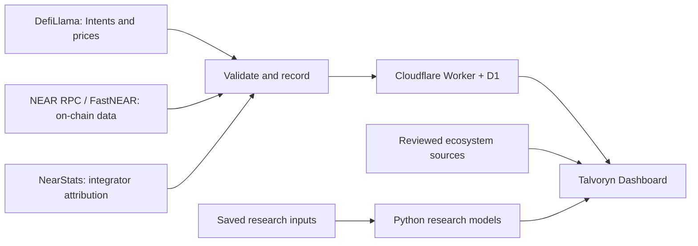

# Talvoryn

**One-stop intelligence and research dashboard for NEAR. Built for NEAR Hackathon 2026.**

[Live Platform](https://talvoryn.pages.dev) · [Methodology](https://talvoryn.pages.dev/methodology.html) · [Catalysts](https://talvoryn.pages.dev/catalysts.html) · [Research Thesis](research-thesis.md)


## Understanding NEAR beyond its price chart

A price chart tells only part of the story. Talvoryn combines **technical analysis (TA)**, **fundamental analysis (FA)** and **on-chain evidence** to research NEAR in one place.

We connect market performance and ecosystem developments with measurable activity—NEAR Intents volume, fees, revenue, buyback-wallet inflows, token supply, integrator adoption and large-wallet exchange flows. The goal is to test an investment thesis against evidence, not assume that rising activity guarantees a rising token price.

## Explore Talvoryn

| Explore | What you can test |
| --- | --- |
| [**Overview**](https://talvoryn.pages.dev/performance.html) | NEAR market performance, Intents volume, fees, revenue, buyback-wallet inflows and supply |
| [**Forecast**](https://talvoryn.pages.dev/research.html) | Adjust issuance, fee, revenue-capture, buyback and price assumptions; compare scenarios |
| [**Catalysts**](https://talvoryn.pages.dev/catalysts.html) | Research governance, upgrades, integrations, adoption and other NEAR developments |
| [**Integrators**](https://talvoryn.pages.dev/integrators.html) | Compare third-party applications' attributed Intents activity and share |
| [**Whale Intelligence**](https://talvoryn.pages.dev/performance.html) | Inspect exchange-related flows across 48 monitored NEAR wallets |
| [**Methodology**](https://talvoryn.pages.dev/methodology.html) | Trace metrics to sources, definitions, formulas and observation dates |

### Three connected research lenses

- **TA — Market behaviour:** compare NEAR's price and relative performance with BTC and ETH.
- **FA — Ecosystem and economics:** assess catalysts, adoption, Intents usage, fees and revenue.
- **On-chain — Observable evidence:** inspect token supply, burns, buyback-wallet transfers and qualifying whale flows.

Together, these help researchers ask whether market movements are supported by meaningful economic activity and verifiable blockchain events.

## Key research features

### Intents activity and token economics

The Overview chart switches between **Volume, Fees, Revenue and Buybacks**, with selectable time intervals and comparisons.

- **Effective fee rate** = fees ÷ volume.
- **Revenue capture** = revenue ÷ fees.
- **Net issuance** = gross issuance − burns.
- **Issuance offset** = (burns + buyback-wallet inflows) ÷ gross issuance.

These are distinct measures: swap volume is not revenue, and a transfer into a buyback wallet is not a burn. The [Methodology](https://talvoryn.pages.dev/methodology.html) explains the source definitions.

### Forecast: test your assumptions

Use [Forecast](https://talvoryn.pages.dev/research.html) to explore how changing Intents activity, fee rate, revenue capture, buyback allocation, issuance or NEAR price affects modelled scenarios. Compare outcomes with the underlying assumptions rather than interpreting a forecast as a guaranteed price.

### Catalysts and integrators

[**Catalysts**](https://talvoryn.pages.dev/catalysts.html) links ecosystem developments to questions about adoption and economic impact. A proposal, announcement and implemented result are treated differently.

[**Integrators**](https://talvoryn.pages.dev/integrators.html) uses NearStats attribution to compare eligible third-party applications across reported time windows. Integrator-attributed activity is distinct from total Intents volume.

### Whale intelligence: follow the transactions

Talvoryn monitors **48 identified NEAR wallets** and calculates qualifying exchange-related flows for rolling **24-hour, 7-day and 30-day** periods.

The current exchange registry contains **26 CEX address entries** for Binance and KuCoin and **2 DEX contracts** associated with Rhea / Ref. CEX transfers are described as deposits or withdrawals, **not automatically buys or sells**. DEX trades require matching successful swap evidence.

**[Inspect the public whale dataset](https://talvoryn.pages.dev/api/whales)**. It includes the wallet cohort, exchange registry, reporting periods and qualifying transaction evidence. The wallet sample is not a network-wide ranking of NEAR holders.

## Reproduce and verify

These checks are intended for hackathon judges, researchers and AI agents. The public endpoints return JSON and require no owner token.

### 1. Check whale addresses, exchange registry and flows

Open [the whale API](https://talvoryn.pages.dev/api/whales), or run the following in the browser console while on `talvoryn.pages.dev`:

```js
const response = await fetch('/api/whales');
if (!response.ok) throw new Error('Whale API: ' + response.status);
const d = await response.json();

console.log('Monitored wallets:', d.roster.length);
console.log('CEX entries:', d.registry.cex.length);
console.log('DEX contracts:', d.registry.dex.length);

console.table(['D', 'W', 'M'].map(key => {
  const p = d.periods[key];
  return {
    period: key, fromUTC: p.from, throughUTC: p.through,
    inflowsNEAR: p.incoming, outflowsNEAR: p.outgoing,
    netNEAR: p.net, calculatedNet: p.incoming - p.outgoing,
    complete: p.complete, qualifyingEvents: p.events.length
  };
}));
```

Compare `netNEAR` with `calculatedNet` in each period. Period completeness and UTC cutoffs are provided alongside the values.

### 2. Verify a recorded exchange movement on-chain

After running the code above:

```js
console.table(d.periods.M.events.slice(0, 10).map(e => ({
  timeUTC: e.timestamp, wallet: e.account, counterparty: e.counterparty,
  venue: e.venue, type: e.kind, amountNEAR: e.amount,
  transaction: e.transaction, receipt: e.receipt
})));
```

For any returned event, inspect its transaction and receipt on [NearBlocks](https://nearblocks.io/). Compare the wallet, counterparty, timestamp, amount and classification with the source transaction. If no event exists in a period, inspect another period; do not invent a transaction.

### 3. Test scenarios, catalysts and data freshness

- [**Forecast**](https://talvoryn.pages.dev/research.html): change one assumption while holding others constant, then compare the modelled outcome.
- [**Catalysts**](https://talvoryn.pages.dev/catalysts.html): open an item and inspect the linked original source.
- [**Integrators**](https://talvoryn.pages.dev/integrators.html): compare applications and attribution periods.
- [**Source health**](https://talvoryn.pages.dev/api/health) and [**Data Freshness**](https://talvoryn.pages.dev/methodology.html): examine the last source check and the date through which observations are available.

### 4. Run the code and automated tests

Requirements: **Node.js 22+**; Python 3.10+ for research scripts.

```bash
git clone https://github.com/ModestusOkoye/talvoryn.git
cd talvoryn
npm run dev
# Open http://localhost:8080
```

Run the core suite and Worker syntax check:

```bash
npm run test:core
npm run build
```

For broader JavaScript tests, use `npm run test:legacy`. The optional `npm run test:scheduled:live` exercises real-source ingestion and local persistence; it contacts external providers.

## Research thesis

**Can growing NEAR Intents activity and broader ecosystem developments translate into stronger, durable economic activity and demand for NEAR?**

Our [working research thesis](research-thesis.md) examines what would support that question—and what would challenge it. Volume growth alone does not prove token demand. The thesis is written for human review and AI-assisted critique, with the original evidence and counterarguments available to inspect.

## Architecture and sources



The website runs on **Cloudflare Pages**, with data collection through **Cloudflare Workers** and persistent datasets in **D1**. Major source checks are scheduled hourly; whale monitoring uses a three-hour schedule. Statistical Forecast model builds are separate from hourly data collection.

**Worker deployment safeguard:** `wrangler.worker.jsonc` is intentionally git-ignored because it contains the production D1 binding. `wrangler.worker.example.jsonc` is the tracked template. Before any future Worker deployment, keep the real D1 database ID, cron triggers and existing secret bindings unchanged, and ensure `"observability": { "enabled": true }` remains in the actual Wrangler config. Worker invocation and persisted logs were enabled in the Cloudflare dashboard on 18 November 2026. The live sampling rate was not independently recorded; do not assume or overwrite it without reviewing the dashboard. Updating this documentation does not deploy the Worker.

More detail: [Technical Methodology](docs/METHODOLOGY.md) · [Data Sources](docs/DATA_SOURCES.md) · [Architecture](docs/ARCHITECTURE.md).

## Research scope and disclaimer

Every dataset has its own source, definition and observation cutoff. The 48 monitored whales are a **sample**; attributed integrator volume is not the entire Intents market; wallet inflows do not by themselves prove market purchases or token burns. Missing observations should not be represented as measured zeros.

Talvoryn is for **research and education**, not investment, financial or legal advice. Scenarios and historical measurements do not guarantee future performance.

---

**Talvoryn — NEAR intelligence through technical, fundamental and on-chain research.**
