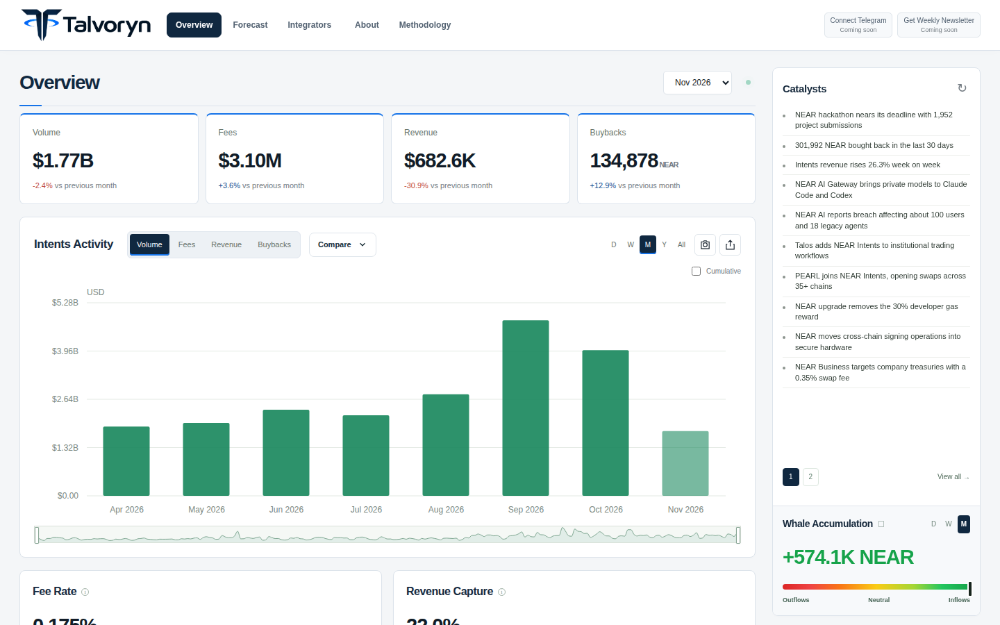
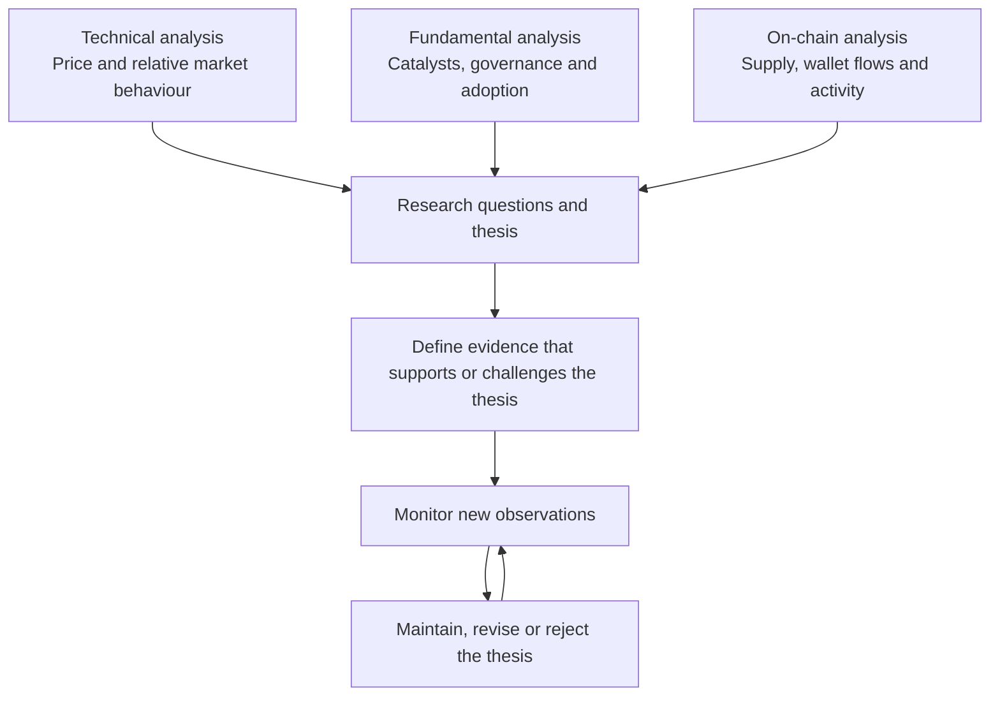
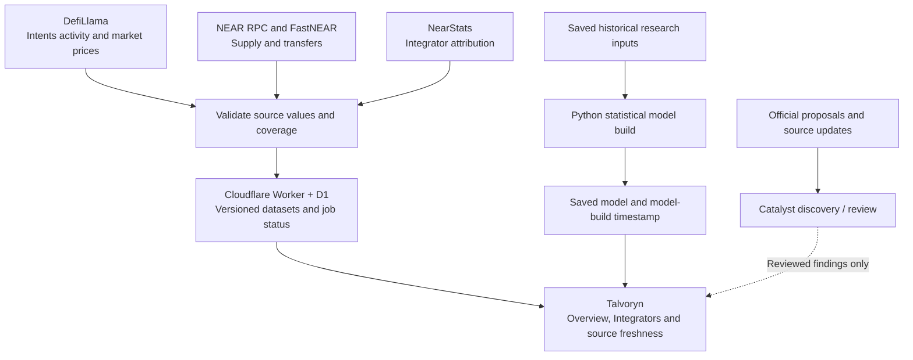

# Talvoryn

**One-stop intelligence and research dashboard for NEAR. Built for NEAR Hackathon 2026.**

[Live Platform](https://talvoryn.pages.dev) · [Methodology](https://talvoryn.pages.dev/methodology.html) · [Catalysts](https://talvoryn.pages.dev/catalysts.html) · [Research Thesis](research-thesis.md)



## Understanding NEAR beyond its price chart

NEAR is an evolving blockchain ecosystem. Following its trajectory means examining **market behaviour (TA)**, **developments that might change its fundamentals (FA)** and **what the blockchain actually records (on-chain analysis)**.

**Talvoryn connects these three perspectives in one research environment.**

NEAR Intents is a central part of that work—not the entire research thesis. Its swaps, fees, revenue, integrations and buyback-wallet activity provide measurable signs of traction. We compare those signals with NEAR's supply, market performance, wallet activity and wider ecosystem catalysts to see whether the evidence supports or challenges our expectations.

The aim is to follow a changing picture of NEAR, form research questions and **revise our conclusions when new evidence demands it**.

## Explore Talvoryn

| Feature | What you can explore |
| --- | --- |
| [**Overview**](https://talvoryn.pages.dev/performance.html) | Market performance, Intents volume, fees, revenue, buyback-wallet inflows and token economics |
| [**Catalysts**](https://talvoryn.pages.dev/catalysts.html) | Governance decisions, protocol upgrades, product launches, partnerships, adoption and other developments relevant to NEAR's fundamentals |
| [**Forecast**](https://talvoryn.pages.dev/research.html) | Issuance-offset, revenue and exploratory price scenarios with adjustable assumptions and comparison |
| [**Integrators**](https://talvoryn.pages.dev/integrators.html) | Activity and attributed market share across eligible third-party applications using NEAR Intents |
| **Wallet intelligence** | Verified exchange-related flows across a monitored sample of large NEAR wallets, surfaced in Overview |
| [**Methodology**](https://talvoryn.pages.dev/methodology.html) | Data sources, formulas, coverage, verification and reproducibility |
| [**Research Thesis**](research-thesis.md) | AI-readable research brief covering the hypothesis, evidence, counterarguments and what to verify next |

## Three pillars of Talvoryn

### 1. Technical analysis (TA) — What is the market doing?

We compare NEAR's market performance with broader conditions, including BTC and ETH. Price trends, momentum and relative performance provide context for the market's reaction to developments.

The research combines market history and relative-performance comparisons, with scope to extend technical indicators over time.

### 2. Fundamental analysis (FA) — What could change NEAR's outlook?

**Catalysts sit at the centre of our fundamental research.** We follow governance and tokenomics proposals, protocol upgrades, ecosystem launches, integrations, partnerships, adoption and competitive developments.

A headline alone is not a conclusion. For each meaningful catalyst, the research asks:

- **What happened?** Is it a proposal, announcement, implementation or verified result?
- **Why does it matter?** Which part of NEAR's adoption, utility or economics might it affect?
- **What should we watch?** What observable evidence could confirm—or challenge—the expected impact?

NEAR Intents contributes fundamental *traction evidence*, but the analysis of NEAR extends beyond Intents.

### 3. On-chain analysis — What does the blockchain show?

Blockchain evidence helps test the fundamental story. Talvoryn examines finalised supply observations, reconstructed issuance and burns, inbound NEAR transfers to the buyback wallet and qualifying exchange-related whale flows.

**Buyback wallet inflows and token supply belong here as measured on-chain evidence.** Their *economic interpretation* also informs fundamental analysis, but they are not the same as governance or product catalysts.

An exchange deposit does not prove a sale; a wallet withdrawal does not prove a purchase. We separate observable transfers from unsupported explanations.

### How the pillars work together



These are **complementary perspectives**, not three interchangeable datasets. A catalyst may suggest a possible change; on-chain and economic observations can help assess whether it materialises; market data shows how the price has behaved.

## How Talvoryn works

Collection and research modelling are separate processes. Different sources can cover different periods, so each measurement keeps its own observation cutoff and recorded check time.



The statistical Forecast model is **not automatically retrained with each hourly data refresh**. Source monitoring can identify candidate catalysts; a candidate is not automatically an approved interpretation or a published story.

### Whale monitoring: free-plan request budgets

The monitoring cohort contains **48 existing verified wallets**, not a network-wide holder ranking. It records qualifying exchange transfers and separately verified DEX swaps, retaining the underlying transaction receipts and per-wallet UTC cutoffs.

**Failure identified on 16 November 2026:** Cloudflare Workers Free permits **50 external subrequests per invocation** (see [Cloudflare's official Workers limits](https://developers.cloudflare.com/workers/platform/limits/)). The earlier whale job allowed **up to 60 FastNEAR transfer queries**, *plus* RPC checks, retries and NearBlocks calls. This exceeded the available per-invocation envelope. Saved failures included eight generic FastNEAR/backup errors and two additional-page checkpoints. Exceeding the Worker limit is a strongly supported root-cause explanation, but it has not been independently proven for every historical error.

**Recovery architecture (implemented in source and tested; requires production deployment and trigger configuration):**

- Divide the same 48-wallet roster deterministically into two 24-wallet batches. Run at **minute 17 and minute 27**, every three hours, as separate Cloudflare Worker invocations. Both batches make up one monitoring cycle.
- Impose a **46-external-fetch hard ceiling per invocation**, covering FastNEAR RPC, indexed transfers, retries and NearBlocks; leave headroom under Cloudflare's 50-request Free cap. FastNEAR transfer pagination has a separate 30-request ceiling per batch.
- Use the authenticated FastNEAR server key first; retrieve only missing transaction intervals. Reuse verified checkpoints and bounded pagination.
- Use NearBlocks only after a real FastNEAR failure. Its native-transfer receipts do **not** establish complete DEX/wNEAR coverage.
- Keep old verified data and identify unfinished windows; never mark partial coverage as zero or complete.

**Configuration note:** The owner-local `wrangler.worker.jsonc` is not committed to the repository. Its `triggers.crons` must include `7 * * * *`, `17 */3 * * *` **and** `27 */3 * * *` before the second batch is live. The existing hourly refresh is unchanged. Tests verify the two-batch processing and limit enforcement; they do not establish live coverage or successful Cron execution. Verify production health and both batch runs after deployment.

### Data schedules and transparency

| Dataset | Collection/check schedule |
| --- | --- |
| Intents volume, fees and revenue | Hourly |
| NEAR, BTC and ETH daily prices | Hourly |
| Current finalised supply observation | Hourly |
| Buyback-wallet transfers | Hourly |
| Integrators | Hourly |
| Sampled whale activity | Every 3 hours |
| Historical issuance and burns | Separate archival reconstruction |
| Catalyst source discovery | Hourly job code added; deployed execution requires verification |

A successful check is not the same as a new observation. The website's [Data Freshness table](https://talvoryn.pages.dev/methodology.html#freshnessTitle) distinguishes **Data through (UTC)** from **Last successful check (UTC)**.

## Research Thesis

[**Read research-thesis.md**](research-thesis.md)

The research thesis is a standalone Markdown brief designed for both human review and AI-assisted analysis. It outlines what Talvoryn is investigating, which measurements support or challenge the hypothesis, what remains uncertain, and the evidence needed to update the view.

**Download or open the file in Claude, ChatGPT, Codex or another AI assistant** to interrogate the thesis, look for counterarguments, compare new evidence, or prepare a dated research update. Include fresh datasets or allow source retrieval for a current assessment; the thesis file alone is not a live data feed.

## Research you can verify

A useful research figure should be traceable. Talvoryn documents **where it came from, what period it covers, how it was calculated and where the evidence is incomplete**.

- [Technical Methodology](docs/METHODOLOGY.md) — formulas, research flows, verification rules, worked examples and reproduction steps
- [Data Sources](docs/DATA_SOURCES.md) — original providers, cutoff definitions and collection schedules
- [Architecture](docs/ARCHITECTURE.md) — Cloudflare infrastructure, persisted datasets, deployment and recovery checks

## Run locally

Requirements: **Node.js 22+** for core tests, **Node.js 24+** for the disk-backed SQLite integration test, **Python 3.10+**, and **NumPy** for statistical model fitting.

```bash
git clone https://github.com/ModestusOkoye/talvoryn.git
cd talvoryn

npm run dev
# Open http://localhost:8080
```

Run core validation and refresh supported sources:

```bash
npm run test:core
python3 -m pip install -r requirements-models.txt
python3 scripts/refresh_performance.py --skip-supply
python3 scripts/refresh_integrators.py
python3 scripts/build_research_models.py
```

The `--skip-supply` flag avoids rerunning expensive archival reconstruction and preserves verified supply evidence. Rebuilding the statistical model is a **separate explicit command**.

Optional real-provider local scheduled-handler test:

```bash
npm run test:scheduled:live
```

This test contacts public providers and exercises local disk-backed persistence. **It does not verify an actual Cloudflare Cron execution.**

## Deployment

- **Cloudflare Pages:** public interface from the `dist/` directory
- **Cloudflare Worker:** read-only data APIs and scheduled source checks
- **Cloudflare D1:** versioned research datasets and collection health
- **Python scripts:** historical reconstruction and statistical model building
- **GitHub:** implementation, tests and reproducible methodology

The public Methodology has displayed successful production D1-backed checks for Intents activity, prices, finalised supply, buybacks and integrators. That is evidence of those **recorded successful checks**, not a guarantee of continuous Cron execution. The separate whale job has not yet displayed successful status. New Catalyst source-discovery code still requires production deployment and verification.

For the precise setup and verification procedure, see [Architecture](docs/ARCHITECTURE.md). Keep credentials in secret storage, not the repository.

## Research coverage and known limits

- Historical issuance/burn reconstruction is incomplete beyond the verified monthly cutoff of **10 November 2026**; daily burn coverage remains incomplete.
- Wallet analysis represents a monitored sample, **not** a verified network-wide ranking of NEAR holders.
- A current total-supply observation does not independently prove historical gross issuance or burns.
- Earlier saved Forecast models may lack a rebuild timestamp; the updated builder records it on future successful builds.
- Catalyst discovery is not the same as reviewed, published fundamental research.
- Exact downloadable public research snapshots remain a future improvement.

The original research evidence is preserved. Missing values are not silently replaced with estimates.

---

**Talvoryn — NEAR intelligence through technical, fundamental and on-chain research.**
