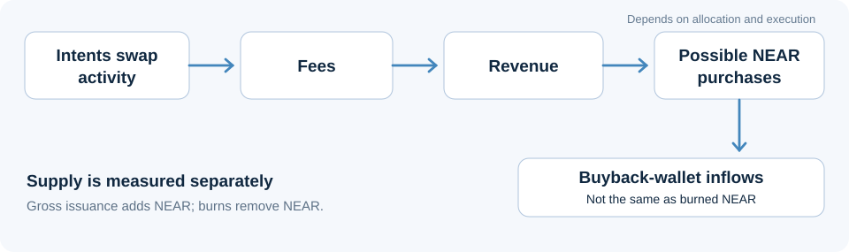
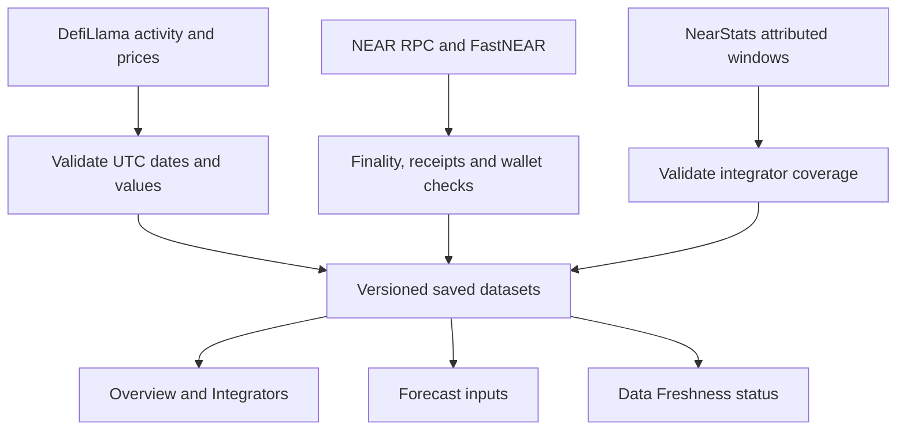
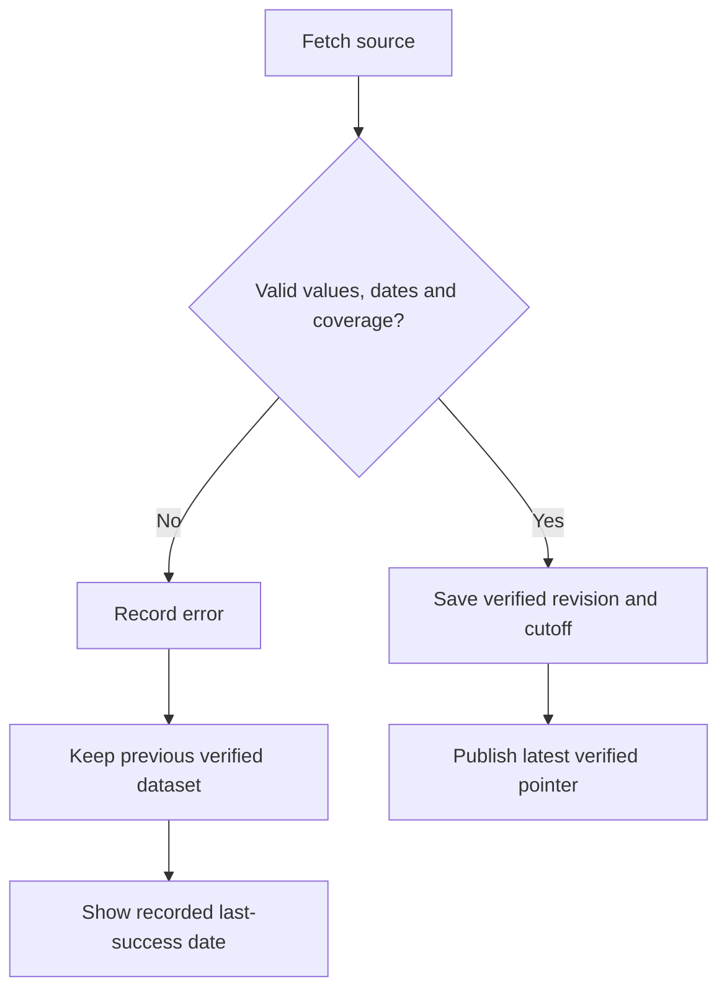
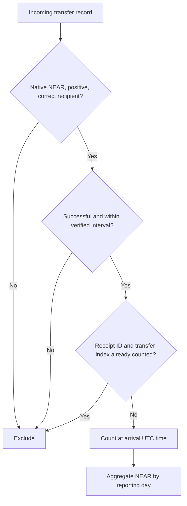
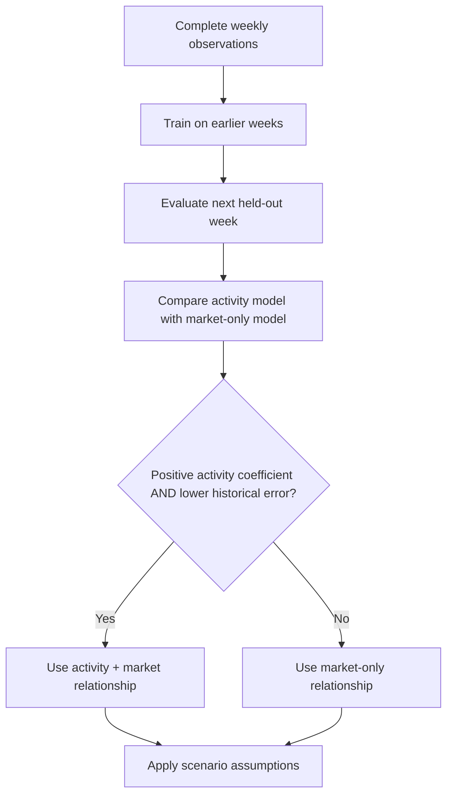

# Talvoryn methodology

> **A research guide to the figures on [Talvoryn](https://talvoryn.pages.dev/methodology.html).** Start with the plain-English explanations, then follow the source links, formulas and scripts to reproduce each supported result.



The figure is a map of possible relationships, **not** proof that every dollar of revenue is spent on NEAR. Buyback-wallet transfers and token burns remain different measurements.

## At a glance

| Question | What we measure | Where to check |
| --- | --- | --- |
| How busy is NEAR Intents? | Swap volume, gross fees and provider-recorded revenue | DefiLlama daily series |
| How much NEAR reaches the buyback wallet? | Successful positive incoming native-NEAR transfers | FastNEAR receipts and NEAR blocks |
| Is NEAR supply increasing? | Gross issuance, burns and their difference | Verified epoch and UTC-boundary block records |
| What are large wallets doing? | Qualifying exchange-related inflows minus outflows | Recognised exchange transfers and proved DEX swaps |
| Which apps route the activity? | Eligible third-party integrator-attributed volume | NearStats windows |
| What might happen under different assumptions? | Issuance offset, revenue and exploratory price scenarios | Model code, saved inputs and holdout tests |

**Dates matter.** All observation dates use UTC. A source checked today can still contain observations ending yesterday. Missing means *unknown*, **not zero**.

### Guide

1. [What we measure](#1-what-we-measure)
2. [Where the numbers come from](#2-where-the-numbers-come-from)
3. [How we analyse the data](#3-how-we-analyse-the-data)
4. [Reproduce and verify our research](#4-reproduce-and-verify-our-research)
5. [Sources, licensing and status](#5-sources-licensing-and-status)

---

## 1. What we measure

### 1.1 Intents activity and earnings

Imagine a payment service processing $100,000 in payments: that $100,000 is activity, **not** the service's earnings. NEAR Intents volume works the same way.

- **Volume** — value of swaps processed through NEAR Intents.
- **Fees** — amounts charged in connection with that activity.
- **Revenue** — provider-defined fee revenue. It is not necessarily profit.
- **Buyback-wallet inflows** — native NEAR received by the designated wallet, including transfers not independently proved to be market purchases.
- **Issuance and burns** — NEAR newly created and NEAR permanently removed from supply.

For a common reporting interval with complete input data:

\[
\text{Effective fee rate}=\frac{\sum\text{fees}}{\sum\text{volume}}
\]

\[
\text{Revenue capture}=\frac{\sum\text{revenue}}{\sum\text{fees}}
\]

A fee rate calculated from daily sums is a **volume-weighted** rate. Averaging each day's rate without weighting could give a different result.

**Input validation:** The DefiLlama adapters must return finite, non-negative values, unique by UTC date. The current UTC day is excluded from complete-day series; a missing date makes a metric's monthly total unavailable rather than silently zero. Providers can revise historical records, and their fee and revenue reporting may have different cutoffs.

**Code:** [Worker ingestion](../worker/production.mjs), [activity refresh script](../scripts/refresh_performance.py).

### 1.2 How supply and buybacks relate

This distinction is fundamental:

\[
\text{Net issuance}=\text{Gross issuance}-\text{Burns}
\]

\[
\text{Issuance offset}=\frac{\text{Burns}+\text{Buyback-wallet inflows}}{\text{Gross issuance}}
\]

A token transferred into a buyback wallet still exists. It is **not burned**. Issuance offset is a research comparison of flows, not the observed change in total token supply. When the issuance denominator is missing or non-positive, the ratio is unavailable.

---

## 2. Where the numbers come from

### 2.1 Source-to-result flow



This describes the main data path. The statistical Forecast model is rebuilt separately by the Python model script; an hourly source check **does not** automatically refit that model.

### 2.2 Sources and observation times

| Dataset | Primary source | Intended checking schedule | What the cutoff means |
| --- | --- | --- | --- |
| Intents volume | [DefiLlama DEX summary](https://api.llama.fi/summary/dexs/near-intents) | Hourly | Latest complete UTC daily observation |
| Fees | [DefiLlama fees](https://api.llama.fi/summary/fees/near-intents?dataType=dailyFees) | Hourly | Latest valid daily fee entry |
| Revenue | [DefiLlama revenue](https://api.llama.fi/summary/fees/near-intents?dataType=dailyRevenue) | Hourly | Latest valid daily revenue entry |
| NEAR/BTC/ETH prices | [DefiLlama coins](https://coins.llama.fi/) | Hourly | Observed daily market-price timestamp |
| Finalised total supply | [NEAR RPC](https://rpc.mainnet.near.org) | Hourly | Timestamp and hash of a finalised block |
| Buyback-wallet inflows | [FastNEAR transfers](https://transfers.main.fastnear.com/v0/transfers) | Hourly | End of completed transfer interval |
| Integrators | [NearStats](https://nearstats.org/api/integrators.json) | Hourly | Provider `dataEndsAt`, distinct from `generatedAt` |
| Sampled whale flows | FastNEAR and finalised RPC records | Every three hours | Common verified wallet-coverage cutoff |
| Gross issuance and burns | Archived NEAR block and epoch evidence | Separate archival research | Last reconstructed and verified boundary |
| Catalysts | Official announcements and source monitoring | Editorial review; source checks separately | Date a specific item was actually checked |

On the public website, the live **Data Freshness** table reads recorded job outcomes from the Cloudflare Worker/D1 backend. Its two time columns mean:

- **Data through:** latest observation in the underlying data.
- **Last successful check:** time the corresponding collection job last successfully completed.

An hourly schedule is **not** a guarantee of fresh source observations every hour. Where a job lacks a verified status, the page says **Unavailable**. See [data source policy](DATA_SOURCES.md) for exact endpoints and refresh semantics.

### 2.3 What happens when retrieval fails?



Duplicate receipts and duplicate daily observations are rejected or deduplicated according to the relevant collector rules. Cross-source comparisons must use **the same date range and measurement definition**. A broader cross-provider comparison panel is planned, not currently claimed as available.

**Code:** [Immutable revisions and job status](../worker/storage.mjs), [ingestion scheduler](../worker/production.mjs).

---

## 3. How we analyse the data

### 3.1 Buyback-wallet inflows

**Account:** `buybacks.multisignature.near`.

Talvoryn's owner-approved definition counts **every successful positive native NEAR transfer received by this wallet**, including possible treasury transfers and refunds. It deliberately describes *wallet inflows*, not necessarily trades executed on an exchange.



The collector paginates FastNEAR results. If an interval is only partially retrieved, that interval cannot be marked complete. Aggregation uses base-unit amounts before converting to NEAR; an overlapping day can be refreshed and replaced without double-counting.

\[
\text{Estimated USD value}=\text{NEAR received}\times\text{NEAR market price on arrival date}
\]

For a *simple arithmetic example*, 100 NEAR arriving on a day with a $3 price observation has an estimated value of $300. **That does not establish $300 spent acquiring the NEAR.**

**Code:** [Buyback ingestion](../worker/production.mjs), [transfer research script](../scripts/refresh_buyback_daily.py).

### 3.2 Supply: separate gross issuance, burns and net issuance

Supply accounting uses finalised block evidence and **complete epoch transitions**, not an assumed annual inflation figure. For a valid epoch transition, the collector reconstructs issued tokens from the observed change in total supply and the burn amount in newly included chunks. Across a reporting period:

\[
\text{Gross issuance}=\sum\text{verified epoch issuance}
\]

\[
\text{Period burns}=\text{Gross issuance}-\left(\text{Ending total supply}-\text{Starting total supply}\right)
\]

The monthly series requires verified UTC boundaries and consistent epoch coverage. The saved historical monthly reconstruction covers **October 2026 and November 1–10, 2026**. Its exclusive cutoff is November 11, 2026. Additional daily historical coverage is incomplete; missing burns are not filled with estimates.

A current finalised supply reading can tell us what total supply was at a particular block. It **cannot** by itself reconstruct issuance or burns for an unobserved historical interval.

**Evidence trail:**

- [Monthly reconstruction](../scripts/refresh_supply.py)
- [Daily reconstruction](../scripts/refresh_supply_daily.py)
- [Supply validation](../scripts/validate_supply.py)
- [Saved monthly evidence](../dist/data/supply-history.json)
- [Daily coverage metadata](../dist/data/supply-daily.json)
- [NEAR source accounting implementation](https://github.com/near/nearcore/blob/9f88300a66a52872b9432dde3287d11e42831e91/core/primitives/src/block.rs)

The original large blockchain evidence archive is preserved separately. Public archival endpoints have returned rate limits; extending coverage requires retrieving and validating the missing records rather than rebuilding previously verified work unnecessarily.

### 3.3 Wallet intelligence

The monitored group comprises a **bounded sample**, not a verified list of every NEAR holder. Wallets must have been assessed at **100,000 NEAR or more**; identifiable exchanges, custodians, treasuries and contracts are excluded from the individual-wallet sample.

The net reading uses **exchange-related flows**, not all transfers:

\[
\text{Net whale flow}=\text{Qualifying incoming NEAR}-\text{Qualifying outgoing NEAR}
\]

| Observation | Included? | Interpretation |
| --- | --- | --- |
| Withdrawal from a published centralised-exchange account | Yes | Exchange-related inflow, **not proven purchase** |
| Deposit to a published centralised-exchange account | Yes | Exchange-related outflow, **not proven sale** |
| DEX swap with a successful log and matching NEAR transfer receipt | Yes | Verified acquisition/disposal |
| Ordinary wallet-to-wallet transfer | No | Could simply be movement between owned accounts |
| Unrecognised counterparty or unproved DEX leg | No | Insufficient evidence |

The displayed main number is **incoming minus outgoing NEAR**. The scale represents incoming ÷ (incoming + outgoing) × 100, when qualifying flow exists. Daily, weekly and monthly windows are published as complete only if the monitored group has the required histories and no unresolved DEX evidence for the period.

**Example:** If verified qualifying inflows total 300 NEAR and outflows 100 NEAR, net flow is **+200 NEAR** and the inflow share is **75%**. This is an explanation of the formula, not a live measurement.

**Code:** [Collector and period checks](../worker/whales.mjs), [Exchange evidence rules](../worker/exchange-flows.mjs), [Wallet tests](../tests/whale-periods.test.mjs). The separate whale scheduled job still requires successful production-status verification.

### 3.4 Forecast: three distinct tools

**A. Issuance-offset scenario.** Inputs include monthly volume, fee rate, capture rate, buyback allocation, NEAR price, issuance, burns, growth and horizon.

\[
\text{Projected revenue}=\text{Volume}\times\text{Fee rate}\times\text{Capture rate}
\]

\[
\text{Modelled NEAR purchases}=\frac{\text{Projected revenue}\times\text{Buyback allocation}}{\text{NEAR price}}
\]

The model tests a chosen offset target; a crossing requires **three consecutive projected months** at or above that target.

**B. Revenue outlook.** Changes monthly volume with an assumed growth path and multiplies by fee and capture rates. This is a scenario based on the user's inputs, not a new observed dataset.

**C. NEAR price outlook.** The existing Python fitter uses non-overlapping complete weekly NEAR/BTC log returns and Intents activity changes. It fits a regularised linear model (ridge regression) and tests predictions through expanding chronological holdouts.



The price chart's historical-variation range is generated from resampled past holdout errors. It is not a statistically calibrated probability interval.

The saved model file includes **`meta.through`** for the data cutoff. Future successful fits also record **`meta.rebuiltAt`**, the actual UTC build timestamp. Older model files with no build timestamp show *Not recorded for this model*; ordinary hourly market refreshes must not be represented as model rebuilds.

**Code:** [Forecast calculations](../dist/research-model.js), [Python fitter](../scripts/build_research_models.py), [Saved model observations](../dist/data/research-models.json), [model tests](../tests/research-model.test.cjs).

### 3.5 Integrators: why the totals differ from Overview

NearStats attributes NEAR Intents activity to named third-party interfaces. The ranking removes first-party, unknown and unlabelled activity and avoids counting intermediate routing layers a second time.

\[
\text{Integrator share}=\frac{\text{Volume attributed to this eligible integrator}}{\text{Total volume attributed to eligible third-party integrators}}
\]

**Overview volume is broader.** Summing the eligible third-party integrators does **not** need to equal the whole of NEAR Intents volume. These figures answer different questions.

NearStats provides rolling **24-hour, 7-day, 30-day and all-time** windows. They overlap; adding them together would double-count activity. Check the provider's `dataEndsAt` separately from `generatedAt`.

**Source and attribution:** [NearStats](https://nearstats.org/) · CC BY 4.0. Individual integrator drill-downs are a future enhancement.

---

## 4. Reproduce and verify our research

A good first check is to follow **one figure** end to end:

1. **Find its original source.** For example, a daily Intents volume point comes from DefiLlama.
2. **Match the reporting dates.** Confirm whether you are looking at a complete UTC day, a rolling window or a partial month.
3. **Apply the same rules.** Check exclusions, missing values, deduplication and the formula.
4. **Compare results.** If the figures differ, first inspect cutoff dates, source revisions and units before concluding something is wrong.

### 4.1 Local reproduction

Requirements: Node.js **22+** for core tests, Node.js **24+** for the local disk-SQLite integration test; Python **3.10+** for the refresh scripts. The statistical fitting script also requires NumPy (see [requirements](../requirements-models.txt)).

Clone the [public repository](https://github.com/ModestusOkoye/talvoryn), then run:

```bash
npm run dev
# Open http://localhost:8080

npm run test:core
python3 -m pip install -r requirements-models.txt
python3 scripts/refresh_performance.py --skip-supply
python3 scripts/refresh_integrators.py
python3 scripts/build_research_models.py
```

**Why `--skip-supply`?** Activity can be refreshed without repeating the costly archival reconstruction or altering saved supply evidence.

Optional integration test:

```bash
npm run test:scheduled:live
```

This explicitly contacts public providers and tests the scheduled handler with local disk-backed SQLite. **It is not proof of a Cloudflare Cron execution.** See [architecture and deployment](ARCHITECTURE.md) for the production verification process. Do not commit API keys or tokens.

### 4.2 Exact historical reproduction vs updating today

These are different jobs:

- **Recalculate using current provider data:** may differ because sources revise history.
- **Reproduce a specific past publication:** requires exactly the dataset and calculation version that produced it.

Talvoryn retains immutable stored revisions in D1. A conveniently downloadable, versioned **public research snapshot package** with provenance and content hashes is a planned extension, not an already available feature.

---

## 5. Sources, licensing and status

**Original data sources**

- [DefiLlama](https://defillama.com/) — NEAR Intents volume, fees, revenue and market data.
- [NEAR RPC](https://rpc.mainnet.near.org) — finalised blocks and supply observations.
- [FastNEAR](https://transfers.main.fastnear.com/v0/transfers) — native transfer records.
- [NearBlocks](https://nearblocks.io/) — independent account and transaction exploration.
- [NearStats](https://nearstats.org/) — third-party integrator attribution, **CC BY 4.0**.

**Ecosystem research**

- [NEAR Protocol](https://near.org/) — announcements and ecosystem context.
- [NEAR Governance](https://gov.near.org/) — proposals and discussions.
- [NEAR Enhancement Proposals](https://github.com/near/NEPs) — protocol change proposals and implementation context.

Catalyst stories should point to the **specific announcement or proposal**, rather than merely the provider's home page. Source discovery checks can produce **private candidates**; they do not automatically establish verified editorial conclusions. The newer monitoring code requires deployed-worker execution verification.

**Known limits:** incomplete historical daily issuance/burns; bounded wallet coverage; missing successful whale-job status; model rebuild dates absent from previously generated files; independent cross-source dashboard and public reproducible snapshots planned.

Talvoryn is independent. Attribution identifies information sources and does not imply their endorsement.

**Related docs:** [Data sources and freshness](DATA_SOURCES.md) · [Architecture and deployment](ARCHITECTURE.md) · [Public Methodology](https://talvoryn.pages.dev/methodology.html).
